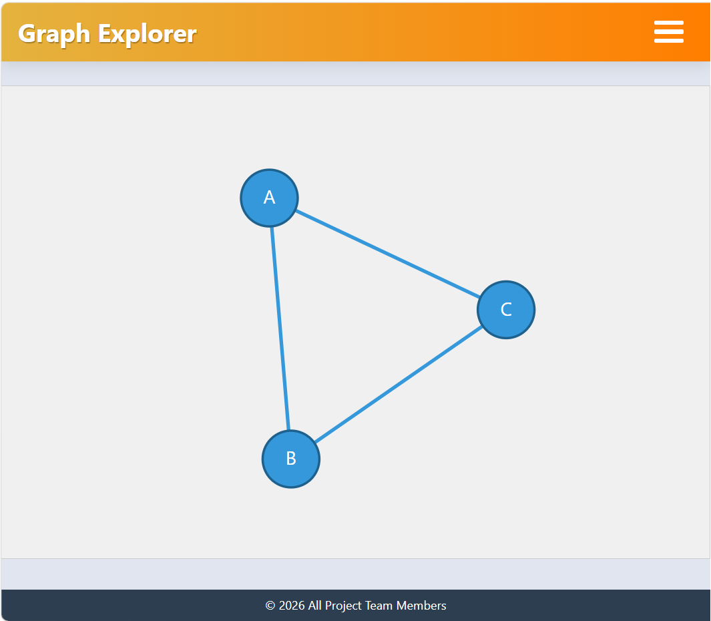

# GraphVisualizer

## Description

A graph visualization tool that allows users to visualize and interact with graphs.

## Features

- Interactive graph visualization
- Add nodes and edges
- Adjustable graph layout and physics settings